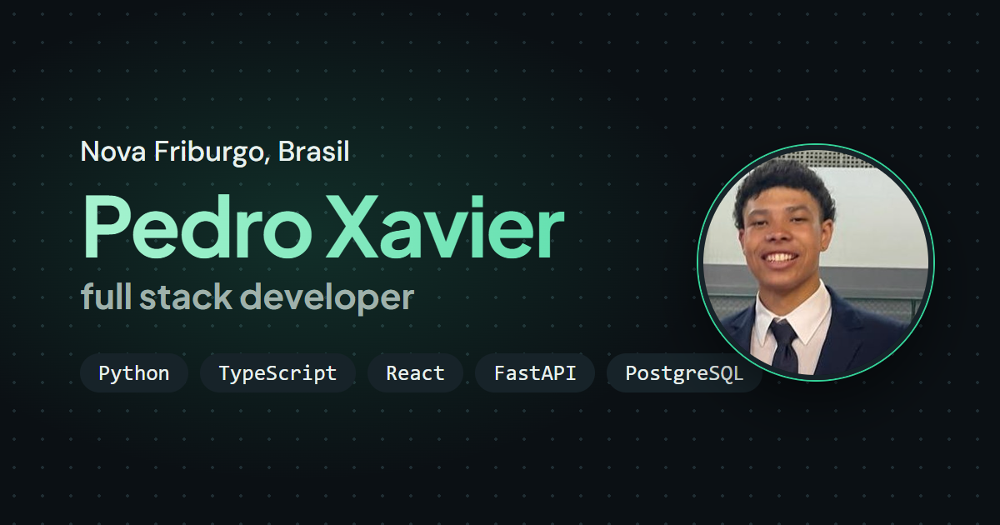

# Pedro Xavier · portfólio

Site pessoal de Pedro Augusto Xavier, desenvolvedor full stack em Nova Friburgo, RJ.

**No ar:** [pedro-xavier.vercel.app](https://pedro-xavier.vercel.app) · [versão em inglês](https://pedro-xavier.vercel.app/en/)



## O que tem

- Português e inglês, com um dicionário de textos tipado (sem biblioteca de tradução) e uma página HTML por idioma gerada no build.
- Tema escuro e claro, que respeita a preferência do sistema e lembra a escolha do visitante.
- Responsivo e acessível: navegação por teclado, contraste AA nos dois temas e animações que param com "reduzir movimento".
- Um assistente de respostas prontas, que roda inteiro no navegador, sem IA e sem servidor.
- SEO: título e descrição por idioma, Open Graph, dados estruturados (schema.org), sitemap e robots.txt.

## Tecnologias

React 19, TypeScript, Vite e CSS puro. Sem framework de UI e sem biblioteca de ícones. Hospedado na Vercel.

## Rodando localmente

```bash
npm install
npm run dev      # servidor de desenvolvimento
npm run build    # checagem de tipos e build de produção
npm run lint
```

O endereço público do site fica em `VITE_SITE_URL`, no arquivo `.env`.

## Projetos mostrados no site

- [Empório Gigi Prado](https://github.com/pedro-augusto-xavier/emporio-gigi-prado): site e sistema de reservas de um restaurante.
- [Sistema para casa espírita](https://github.com/pedro-augusto-xavier/sistema-casa-espirita): sistema web de gestão com login e controle de acesso.

---

**Contato:** pedroaugustoxmachado@gmail.com · [LinkedIn](https://www.linkedin.com/in/pedro-augusto-xavier-machado-bb1133345)
